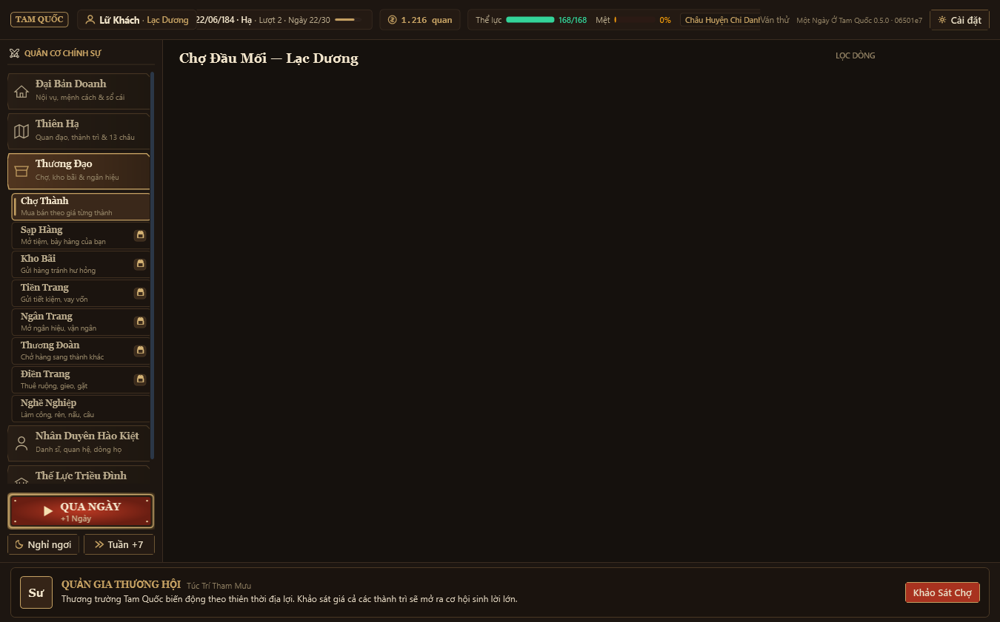
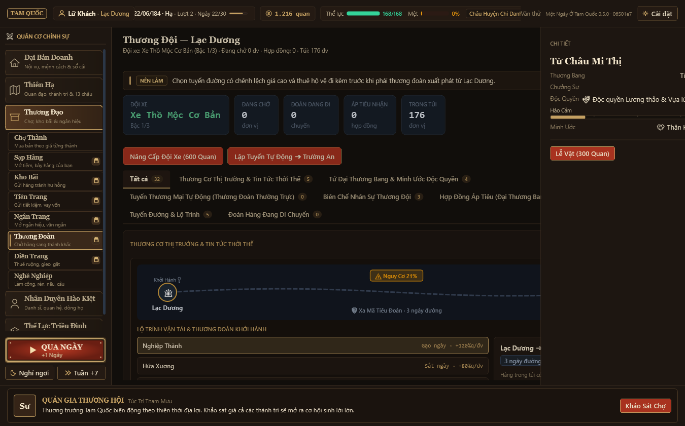
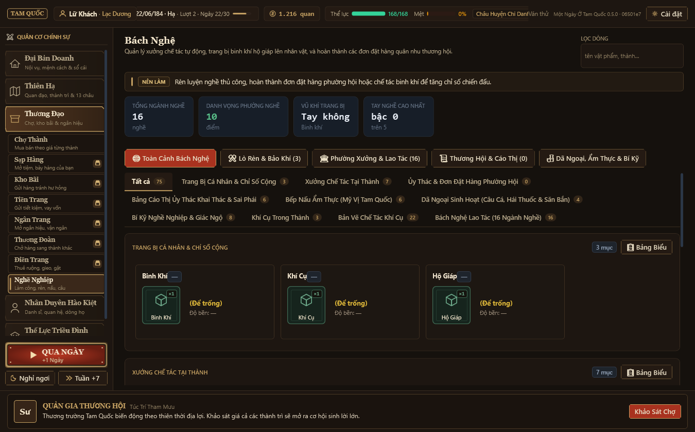
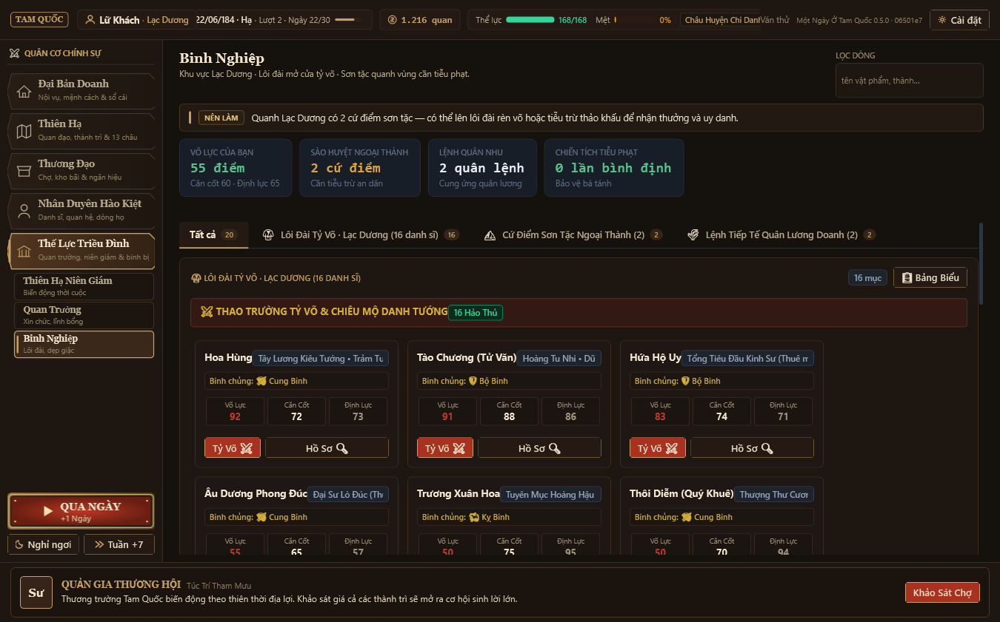
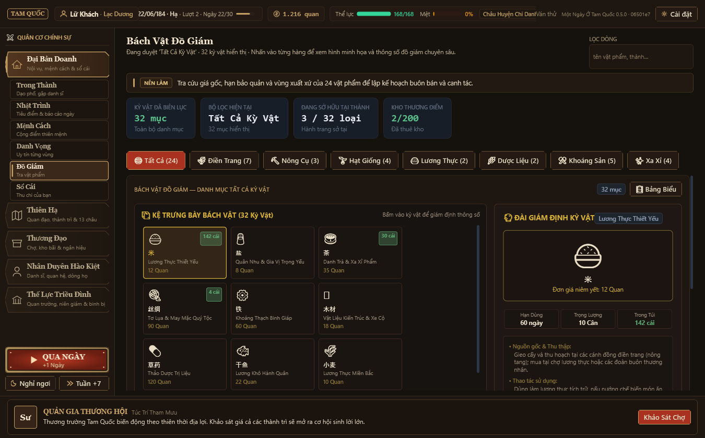
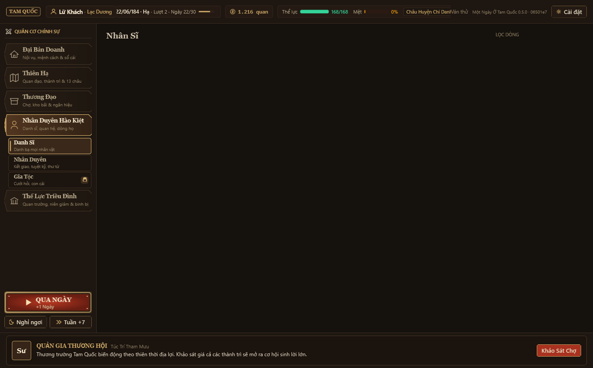
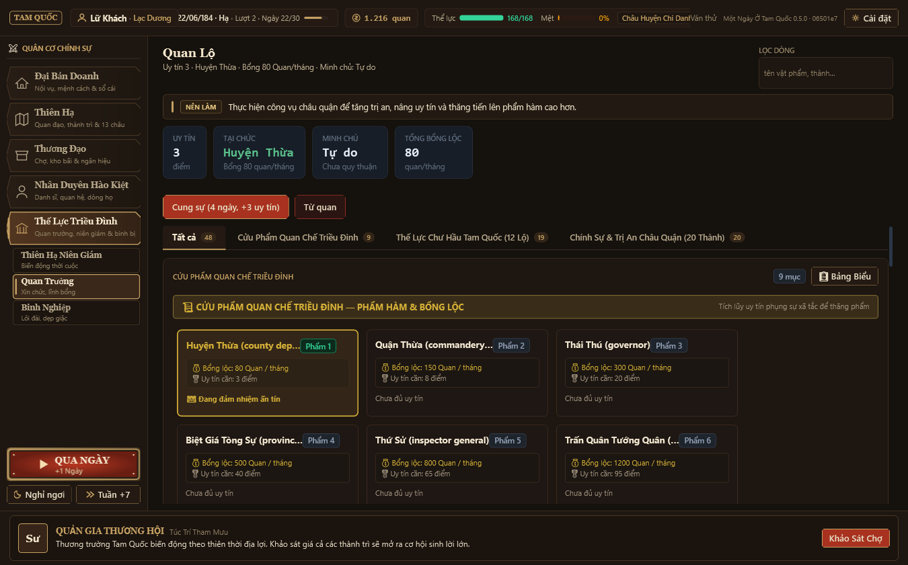
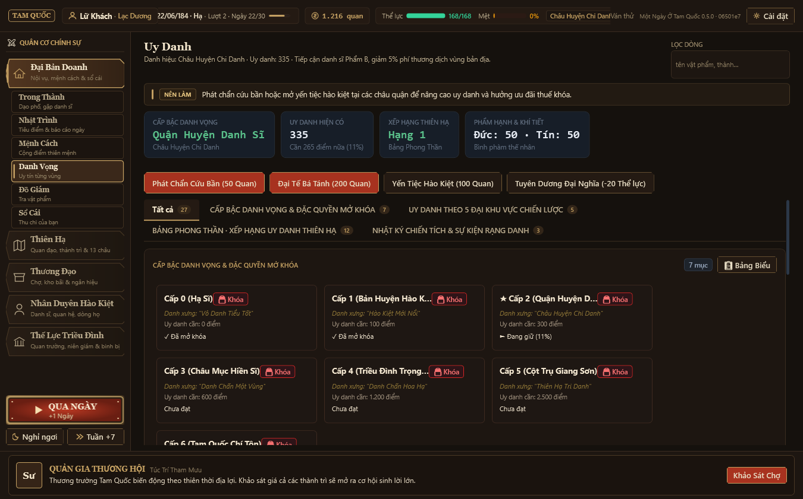

# A Day in the Three Kingdoms (Một Ngày Ở Tam Quốc · SimT)

[](tests/)
[](docs/module-authoring.md)
[](src/SimT.Host.Wpf/)
[](LICENSE)

A single-player, offline, text-and-tactical merchant simulation for Windows, built as a **Core + DLC
modular monolith**. This repository is a deliberate restart of the `Simulation` web project:
same game genre, but the architecture that project only documented is enforced here from the
first commit by the compiler and by an architecture test suite.

---

## Visual Showcase (Immersive Feudal UI)

The desktop client features specialized, thematic UI decks designed to replace generic tabular data with atmospheric Three Kingdoms craftsmanship while supporting instantaneous dual-mode toggling (`[ 🎨 Trực quan ]` $\leftrightarrow$ `[ 📋 Bảng biểu ]`):

| Bazaar Trading Deck | Caravan Dispatch Board |
| :---: | :---: |
|  |  |
| *2-column market shelf, rarity slots, deal tray, and price charts* | *Crew triptych (WAR/COM/LOG), trail canvas, and guild contracts* |

| Artisan Workbench & Forge | Tactical War Camp |
| :---: | :---: |
|  |  |
| *Crucible anvil, socketed materials, quality forecasting & equipment cards* | *Warrior duel roster, troop affinities, and bandit strongholds* |

| Item Codex Showcase | NPC Hero Directory |
| :---: | :---: |
|  |  |
| *Multi-column commodity shelf and appraisal pedestal with lore specs* | *Three Kingdoms heroes, scholar badges, and 4-pillar attribute pills* |

| Imperial Court Chamber | Reputation Hall of Fame |
| :---: | :---: |
|  |  |
| *Nine-Rank Official hierarchy, 12 warlord factions, and regional policies* | *Renown tier ladder, 5 strategic macro-regions, and leaderboard* |

---

## Why a new project

The web build reached 52k lines of TypeScript, 206 HTTP endpoints and a session-lease layer
(60 s leases, heartbeats, `423 SESSION_LOCKED`) to manage instances of a game that is played by
one person against one local database. For an offline single-player title that machinery is pure
overhead: no HTTP, no leases, no bundle rebuilds. A desktop process with one SQLite file per
campaign replaces all of it.

## What "Core + DLC" means here

| Layer | What belongs | What must never appear |
| --- | --- | --- |
| `SimT.Contracts` | Interfaces, DTOs, value objects, capability ids, UI section contracts | Any project or package reference |
| `SimT.Core` | Kernel: database, clock, ledger, ids, RNG, events, config, module runtime, idempotent migrations | Any business noun (market, warehouse, citadel…) |
| `SimT.Modules.Base.*` | Always-installed game pillars: content, world, player, npc | References to other modules |
| `SimT.Modules.Dlc.*` | 4 Consolidated DLC Pillars: `Economy`, `Character`, `Power`, `Society` | References to base modules' assemblies |
| `SimT.Host.Wpf` | Shell, save picker, ROTK tactical HUD, Imperial Time pill, thematic deck controls, dual-mode renderer | Knowledge of any module type |
| `SimT.Cli` | Golden replay, balance simulation, manifest lint | Knowledge of any module type |

Dependency direction is checked, not asserted — see `tests/SimT.Architecture.Tests`.

## Adding a feature later (the point of the design)

A new feature is a new DLC or an extension to an existing Pillar: create a project, add `module.json`, add `migrations/*.sql`, declare
owned tables, expose capability interfaces, register screens, then add the module id to
`assets/products/*.json`. Core and the WPF shell are not edited. Removing the id disables the
feature while the save keeps its data intact.

Full recipe: [docs/module-authoring.md](docs/module-authoring.md).

## Quick Start & Running the Game

To launch the desktop game directly from the root repository:

```cmd
run.cmd
```

Or build and run via the .NET CLI:

```bash
dotnet build SimT.sln
dotnet test SimT.sln
dotnet run --project src/SimT.Host.Wpf        # desktop game
dotnet run --project src/SimT.Cli -- info     # where modules and assets resolve
```

`verify.cmd` runs the whole gate: Release build, all tests, then the golden replay.

## Release

```bash
release.cmd
```

Builds, tests, publishes the framework-dependent single-file Windows build, smoke-runs it and
writes `dist/SimT-<version>-win-x64.zip` with a SHA-256. The player needs the .NET 8 Desktop
Runtime; save data lives in `%APPDATA%\SimT`. Details: [docs/release.md](docs/release.md).

## Golden replay

```bash
dotnet run --project src/SimT.Cli -- golden samples/merchant-30d.json  samples/merchant-30d.expected.txt
dotnet run --project src/SimT.Cli -- golden samples/merchant-full.json samples/merchant-full.expected.txt
```

The hash covers every ledger line: date, journal code, direction, amount and running balance.
Same seed plus same action script must produce the same hash, so a rules refactor cannot change
the numbers silently. Every replay also runs all registered invariants and exits non-zero if
any table contradicts another.

## Consolidated DLC Pillars & Base Modules

The gameplay systems are structured into cohesive, deep architectural modules:

| Module | Kind | Focus Domains | Owned Schema |
| --- | --- | --- | --- |
| `base.content` | Base | 32 trade goods, Item Encyclopedia Hub, and external JSON Modding SDK (`mods/*.json`) | `ct_item` |
| `base.world` | Base | 20 citadels, 133 urban sublocations, 24 bidirectional trade routes, CityStroll interactive encounters | `wd_citadel`, `wd_route` |
| `base.player` | Base | Protagonist attributes, per-city bag, wallet facade, 5 Endgame Ambitions, and 11-badge Achievement Hall | `pl_player`, `pl_bag` |
| `base.npc` | Base | 278 historical & procedural characters across 20 citadels | `np_npc` |
| `dlc.economy` | Pillar | Market trading, seasonal prices, warehouses, banking & private banks, caravan logistics, professions, and farmland cultivation | `mk_*`, `cv_*`, `pf_*`, `fm_*` |
| `dlc.character` | Pillar | NPC relationship tiers, dialogue trees, sworn brotherhood, marriage, children, political marriages, and multi-generational heir succession | `kz_*`, `dg_*`, `ln_*` |
| `dlc.power` | Pillar | Court official appointments, regional fiefdoms, martial duels, bandit strongholds, and Yangtze naval shipyards & riverine campaigns | `po_*`, `ml_*` |
| `dlc.society` | Pillar | Autonomous 278-NPC simulation, rival merchants, karma consequences, covert spy network (`Tế Tác`), and 5 Legendary Hermit Tomes | `so_*` |

### Backward Compatibility & Idempotent Migrations
Legacy saves containing historical records from individual micro-modules (`dlc.market`, `dlc.caravan`, etc.) are automatically normalized and mapped to the 4 Pillars via `SaveManager.NormalizeModules` and a global idempotent `MigrationRunner`.

## User Interface & Experience (UI/UX)

- **Thematic Dual-Mode View Routing**:
  - Every migrated section features an ergonomic header pill toggle `[ 🎨 Trực quan ]` $\leftrightarrow$ `[ 📋 Bảng biểu ]`. Players can switch between specialized graphical controls (Bazaar Deck, Caravan Board, Forge Crucible, War Camp, Court Chamber, Item Codex, NPC Dossier, Treasury Vault) and standard tabular DataGrids anytime.
- **Zero Domain Pollution**:
  - `SimT.Modules.*` remain 100% agnostic of WPF and XAML, communicating UI hints exclusively through the `SectionViewMode` enum in pure C# contracts (`SimT.Contracts.Ui.IUiRegistry`).
- **Top Header Imperial Time HUD & Visual Vitals**:
  - Integrated into the top command banner with calendar date, season, turn number, 30-day progress bar, and real-time Stamina, Fatigue, and Prestige Standing gauges.
- **Contextual Strategic Ribbon & Recommendation Banner**:
  - Categorized left command ribbon (Sa Bàn 13 Châu, Thương Đạo, Thế Lực Triều Đình, Nhân Duyên Hào Kiệt, Bản Thân & Sổ Sách) where each sub-item displays a 1-line description and active to-do badge, paired with the square Jade Seal ("QUA NGÀY") and contextual `"NÊN LÀM"` recommendation banner.
- **Full-Body Sprite Animation & Interactive WebView2 Scenes**:
  - **Sprite Animation Runner (`assets/scenes/sprite-anim.js`)**: Renders 24-frame horizontal strips (`traveler.png`, `han_officer.png`, `guan_yu.png`, `zhang_fei.png`) and expressive static sprites across Duel (`duel`), City (`city`), and Talk (`talk`) stages.
  - **Interactive Feature Scenes**: World Map (`world.map` with auto-fit 20-citadel view, Dijkstra routes, and travel animation), Social Network (`social.network` with concentric affinity rings, 6 skill slots, letters, and retainers), Market Stall (`market.stall` with 10-day price history and top-3 city arbitrage), and Character Dossier (`npc.directory` with custom portraits, 8-axis radar chart, special skills, and biography).
- **Bilingual Internationalization (i18n)**:
  - Full English and Vietnamese localization for all UI surfaces, menus, commodities, and dialogs.
  - Seamless, in-session language switching via the Settings modal (`Key.O`) without requiring application restart.
- **Endgame Ambitions & Legacy Epilogues**:
  - 5 grand historical paths: Kingmaker (Triều Đình), Merchant Sovereign (Phú Khả Địch Quốc), Dynasty Patriarch (Thế Gia Trọng Tộc), Grand Martial Master (Võ Lâm Chí Tôn), and Renowned Sage (Nhất Đại Danh Sĩ).
  - Dedicated progress tracker (`Key.V`) featuring 0–100% milestone completion and unique narrative epilogues upon victory.
- **Regional Weather & 24 Solar Terms (Tiết Khí)**:
  - Deterministic 8-weather state engine (Clear, Cloudy, Rain, Torrential, Gale, Snow, Blizzard, Drought) mapped across 24 solar terms and 5 historical macro-climatic regions.
  - 5-day weather forecast influencing market supply/demand price fluctuations and farmstead soil moisture/yield resonance.
- **Trade Arbitrage Compass & Regional Price Heatmap**:
  - Commodity arbitrage radar (`Key.B`) providing real-time minimum purchase and maximum sale prices across all 20 historical citadels.
  - Top 3 optimal trading corridors with transit day calculations and profit projections for 40-unit caravan packs.
  - 20-citadel regional price heatmap grouped into 5 macro-regions with visual status badges (`GAIN`, `LOSS`, `BALANCED`).
- **Deep Officialdom, Governor Fiefdom & Promotion/Demotion**:
  - Full Nine-Rank career progression with quantitative Merits (Huân Công) and active promotion petitions (`RequestPromotion`).
  - Strict ministerial demotion and censure (`DemoteOffice`) when failing consecutive lord tasks or mismanaging local famine/unrest.
- **Governor's Manor (Thái Thú Phủ) & Imperial Council Memorials**:
  - Rank 3+ ministers administer agricultural reclamation, commerce markets, fortification defense, and public order with local treasury accounts, autonomous aides, fief megaprojects, and siege defense.
  - Submit formal Imperial Council Memorials (Triều Hội Thượng Tấu) to petition warlords for economic reforms, military campaigns, personnel appointments, or disaster relief.
- **Cross-Pillar Intrigue, Economic Warfare & Proactive Strategic Briefing**:
  - **Economic Warfare (`dlc.economy`)**: Market cornering monopolies (`CornerMarket`) and high-risk contraband smuggling corridors (`SmuggleContraband`).
  - **Retainer Ambition & Treasury Audit (`dlc.character`)**: Retainer ambition friction, embezzlement detection, formal audits (`AuditRetainer`), and sworn brother combat/intrigue assistance (`RequestSwornAssist`).
  - **Warlord Scrutiny & Court Factions (`dlc.power`)**: Dynamic warlord suspicion/extortion demands (`AppeaseWarlord`), court faction standing, lobbying (`LobbyFaction`), and imperial censorate inspections (`HandleImperialInspection`).
  - **Proactive Strategic HUD (`SimT.Host.Wpf`)**: `TopProposalCard` daily action advisor, `GameStrategicBriefingControl` 360-degree command overview, and real-time survival/threat pulse mitigation banners.
- **Comprehensive Desktop Hotkey Navigation**:
  - `Space` / `W`: Advance 1 day / 7 days
  - `M`: World Map (`world.map`)
  - `C`: NPC Directory & Characters (`npc.directory`)
  - `K`: Citadel Market & Bazaar (`market.stall`)
  - `T`: City Stroll & Reconnaissance
  - `V`: Endgame Ambitions Modal
  - `B`: Trade Arbitrage Compass Modal
  - `O`: Game Settings & Language Selection Modal
  - `F3`: Debug Metrics Overlay

## Verification snapshot

| Gate | Count | Command |
| --- | --- | --- |
| Architecture rules | 44 | `dotnet test tests/SimT.Architecture.Tests` |
| Kernel primitives, contracts and hardening | 164 | `dotnet test tests/SimT.Core.Tests` |
| Consolidated DLC Pillars behavior | 479 | `dotnet test tests/SimT.Modules.Dlc.Tests` |
| Commodity market mechanics | 50 | `dotnet test tests/SimT.Modules.Market.Tests` |
| WPF Desktop Host component tests | 22 | `dotnet test tests/SimT.Host.Wpf.Tests` |
| **Total test suite** | **759** | `dotnet test SimT.sln` |
| Golden ledger hashes | 2 | `SimT.Cli golden …` |
| Invariants at end of every replay | 60 | printed by `SimT.Cli` |
| WPF render smoke | 1 | `SimT.Host.Wpf.exe --smoke` |

## Documents

- [docs/architecture.md](docs/architecture.md) — kernel services, boundaries, save model.
- [docs/module-authoring.md](docs/module-authoring.md) — step-by-step DLC recipe.
- [docs/decisions.md](docs/decisions.md) — the choices and the rejected alternatives.
