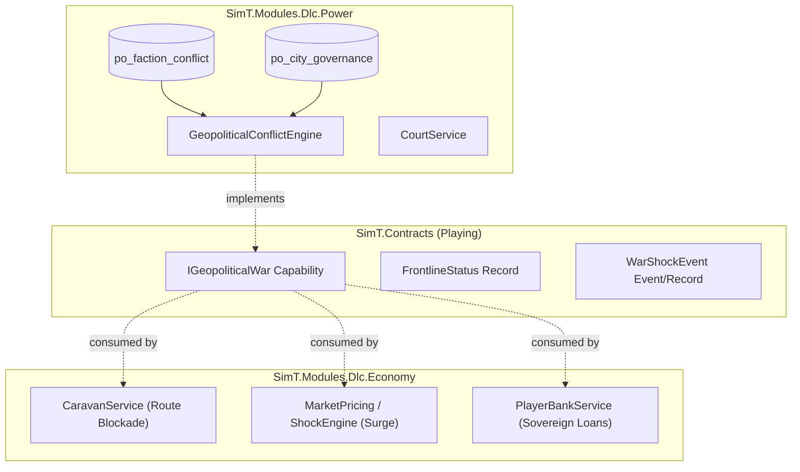

# Technical Specification — Living War & Macro Geopolitics Engine

Target Branches: Feature branches under `feat/living-war-geopolitics`  
Reference: `docs/spec/nang-cap-tam-quoc.md`, `PowerModule`, `EconomyModule`

---

## 1. Executive Summary & Design Vision

In SimT, politics has already achieved a solid micro-level roleplay foundation (ranks, court stipends, lord tasks, and duels). However, national/macro geopolitics remained largely static. 

The objective of this specification is **NOT** to turn SimT into a tactical grand-strategy map-painter (like Romance of the Three Kingdoms 14), but to establish **War and Geopolitics as an Ambient Systemic Driver (Lực đẩy ngoại cảnh)** that permeates the entire simulation ecosystem—directly influencing merchants, farmers, bankers, bureaucrats, and martial characters alike.

---

## 2. Core Architecture & Boundary Preservation

SimT enforces strict module boundary isolation (`Modules_do_not_read_foreign_tables`). `SimT.Modules.Dlc.Economy` cannot join against `po_` tables, and `SimT.Modules.Dlc.Power` cannot query `bk_` or `cv_` tables.

Cross-module coupling is achieved exclusively through **Capabilities and Contracts** defined in `SimT.Contracts.Playing`.



---

## 3. Data Schema & Migrations (`dlc.power`)

### Migration: `0705-geopolitical-conflicts.sql`
```sql
-- 0705-geopolitical-conflicts.sql — Dynamic Faction Conflicts & Contested Frontlines
CREATE TABLE IF NOT EXISTS po_faction_conflict (
    id INTEGER PRIMARY KEY AUTOINCREMENT,
    attacker_faction_id INTEGER NOT NULL,
    defender_faction_id INTEGER NOT NULL,
    target_citadel_id INTEGER NOT NULL,
    intensity INTEGER NOT NULL DEFAULT 1,      -- 1: Skirmish, 2: Clashing, 3: Full Siege
    war_stage TEXT NOT NULL DEFAULT 'SKIRMISH',-- 'SKIRMISH', 'SIEGE', 'BREACH', 'PACIFIED'
    started_day_index INTEGER NOT NULL,
    siege_progress INTEGER NOT NULL DEFAULT 0, -- 0..100
    supply_attrition INTEGER NOT NULL DEFAULT 0,
    status TEXT NOT NULL DEFAULT 'ACTIVE'      -- 'ACTIVE', 'RESOLVED_VICTORY', 'RESOLVED_REPULSED', 'TRUCE'
);

CREATE INDEX IF NOT EXISTS ix_po_conflict_citadel ON po_faction_conflict(target_citadel_id, status);
CREATE INDEX IF NOT EXISTS ix_po_conflict_factions ON po_faction_conflict(attacker_faction_id, defender_faction_id, status);
```

---

## 4. Systemic Mechanics Across Personas

### 4.1. Geopolitical Conflict Engine (`dlc.power`)
- **Monthly Turn Simulation**: On each month boundary tick (`Clock.AdvanceDays` crossing month or quarterly cycle):
  - Check bilateral faction tensions.
  - Active conflicts advance: Attacker strength vs Defender citadel `defense_strength` and garrison.
  - If `siege_progress >= 100`:
    - Citadel changes ownership: `po_city_governance.faction_id = attacker_faction_id`.
    - Citadel suffers high unrest: `unrest_level = 75%`.
    - `defense_strength` drops by 30%.
    - Chronicle event recorded in `so_journey_log` (`event_kind = 'history'`).
  - If Defender successfully repels or reaches truce: Conflict concludes, restoring trade routes.

### 4.2. Economic Impact & Merchant Arbitrage (`dlc.economy`)
1. **Trade Route Blockade & Hazards (`CaravanService`)**:
   - Caravan routes passing through or targeting a `target_citadel_id` with active conflict `intensity >= 2` encounter **War Zone Hazard**:
     - Travel duration penalty (+20% to +50% travel days due to military checkpoints).
     - Spoilage rate doubled for perishable food items.
     - Ambush risk increased unless player hires high-ranking guards (`CaravanCrew`).
2. **War Commodity Pricing Shocks (`MarketPricing` & `MarketShockEngine`)**:
   - Cities under `SIEGE` automatically register a systemic market shock:
     - **Grain / Provisions**: Price surge +80% to +180%.
     - **Iron / Weapons / Armor**: Price surge +100% to +250%.
     - **Medicinal Herbs**: Price surge +60% to +120%.
   - Luxury goods drop in value as survival supplies dominate consumer demand.
3. **Sovereign War Financing (`PlayerBankService`)**:
   - Expanding on `bk_faction_loan`: Factions engaged in active conflicts seek high-value emergency war loans (`5,000` to `20,000` Quan).
   - In exchange for funding their war chest, the faction offers:
     - High monthly interest (7%–10%).
     - Faction-wide toll exemptions (`TAX_EXEMPT_NORTH`, `RIVER_PORT_EXCLUSIVE`).
     - Exclusive mineral purchasing rights.
     - Default Risk: If the faction loses its major capitals or collapses, loans turn delinquent!

### 4.3. High-Value Military Logistics Contracts (`MilitaryRequisitions`)
- Factions issue urgent military requisition tenders:
  - "Giao nộp 2,000 thạch Lương thảo tới tiền tuyến Tương Dương trong 45 ngày."
  - Reward: Premium purchase price + faction prestige + Court promotion points.

---

## 5. Phased Implementation Roadmap

| Phase | Milestone | Primary Modules | Key Deliverables |
| :--- | :--- | :--- | :--- |
| **Phase 1** | **Contracts & Data Model** | `SimT.Contracts`, `SimT.Modules.Dlc.Power` | • `IGeopoliticalWar` interface & DTOs.<br>• Migration `0705-geopolitical-conflicts.sql`.<br>• Manifest update in `dlc.power/module.json`. |
| **Phase 2** | **Conflict Simulation Engine** | `SimT.Modules.Dlc.Power` | • `GeopoliticalConflictEngine.cs`.<br>• Monthly tick simulation (siege progress, defense attrition, citadel handover).<br>• Unit & invariant tests. |
| **Phase 3** | **Economic Coupling** | `SimT.Modules.Dlc.Economy` | • Frontline price shock hook in `MarketPricing`.<br>• War zone danger & route delays in `CaravanService`.<br>• Faction emergency loans in `PlayerBankService`. |
| **Phase 4** | **UI & Chronicle Integration** | `SimT.Host.Wpf`, `SimT.Modules.Dlc.Society` | • Map faction influence overlay updates.<br>• Strategic briefing frontlines radar.<br>• Chronicle announcements for major sieges. |

---

## 6. Engineering Verification & Quality Gates
- **`R_TDD`**: Write automated unit tests verifying siege mechanics, price shifts, and caravan hazards *before* merging into release.
- **`R_PROOF`**: 0 compilation warnings, 100% green tests in `SimT.Modules.Dlc.Tests`.
- **`R_REUSE`**: Re-use existing `MarketShockEngine`, `CaravanInvariants`, and `0210-player-bank-faction-loans.sql` logic without code duplication.
- **`R_GIT`**: Target atomic commits per phase under `feat(power):` and `feat(economy):`.
